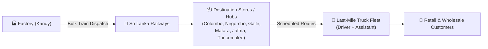

# 🚆 kandypack - Rail & Road-based Supply Chain Distribution System

[](https://www.python.org/)
[](https://streamlit.io/)
[](https://www.postgresql.org/)
[](https://www.docker.com/)

**kandypack** is an enterprise supply chain and database-driven logistics platform designed for a mid-sized FMCG manufacturing company based in Kandy, Sri Lanka. The platform manages island-wide multimodal distribution combining **bulk railway transit** with **road-based last-mile delivery**, backed by a PostgreSQL database and an interactive Streamlit management interface.

---

## 📋 Table of Contents

- [Business Domain & Logistics Workflow](#-business-domain--logistics-workflow)
- [Core Business Rules & Constraints](#-core-business-rules--constraints)
- [Management Reports](#-management-reports)
- [Key Features & Web Interface](#-key-features--web-interface)
- [Tech Stack](#-tech-stack)
- [Project Structure](#-project-structure)
- [Quick Start with Docker](#-quick-start-with-docker-recommended)
- [Environment Variables](#-environment-variables)
- [Database Management & Useful Commands](#-database-management--useful-commands)
- [Team & Individual Contributions](#-team--individual-contributions)
- [License](#-license)


---

## 🏢 Business Domain & Logistics Workflow

Kandypack manufactures fast-moving consumer goods (FMCG) in Kandy and distributes them across Sri Lanka to wholesale and retail clients.



1. **Bulk Railway Transport**: Goods are shipped from Kandy via Sri Lanka Railways to key regional hub stations:
   - **Colombo**, **Negombo**, **Galle**, **Matara**, **Jaffna**, and **Trincomalee**.
2. **Intermediate Warehousing**: Goods are received, unloaded, and buffered at destination stores located adjacent to railway stations.
3. **Road Last-Mile Delivery**: Dedicated trucks execute predefined route deliveries from the stores to customer addresses within designated geographical service areas.

---

## ⚖️ Core Business Rules & Constraints

### 1. Rail Transport & Cargo Space Consumption
- **Train Capacities**: Fixed cargo capacity per train trip.
- **Space Consumption Rate**: Each product type has a defined space unit consumption rate (e.g., 1 box of detergent = 0.5 space units).
- **Rollover Scheduling**: If total order volume exceeds train capacity for a scheduled trip, excess inventory is rolled over and scheduled for the next available trip.

### 2. Orders & Advance Placement
- **Advance Booking**: Orders must be placed **at least 7 days in advance**.
- **Multi-Item Orders**: Orders contain multiple product items, quantities, and line-item details.
- **Route Matching**: Order delivery addresses are strictly mapped to the corresponding delivery route covering that area.
- **Lifecycle Tracking**: Delivery statuses are tracked through `Pending`, `Scheduled`, `In-Transit`, and `Delivered`.

### 3. Crew Scheduling & Labor Compliance
- **Crew Assignment**: Every truck delivery requires 1 Driver and 1 Driver Assistant.
- **Conflict Prevention**: No truck, driver, or assistant may have overlapping or conflicting delivery schedules.
- **Driver Roster Rules**:
  - Must **not** be scheduled for two consecutive truck deliveries.
  - Maximum **40 working hours per week**.
- **Driver Assistant Roster Rules**:
  - May be scheduled for a maximum of **two consecutive routes**.
  - Maximum **60 working hours per week**.

---

## 📊 Management Reports

The platform is designed to produce key operational and business intelligence reports:

1. **Quarterly Sales Report**: Sales volume and monetary value broken down by product lines and quarters.
2. **Most Ordered Items**: Top-selling products ranked by volume and frequency per quarter.
3. **City & Route Sales Breakdown**: Revenue and order density distributed across destination cities and local delivery routes.
4. **Driver & Assistant Working Hours**: Audit log of hours worked per week/month to enforce roster compliance and payroll accuracy.
5. **Monthly Truck Utilization**: Trip frequencies, cumulative mileage, and maintenance/usage analysis per vehicle.
6. **Customer Order & Delivery History**: End-to-end audit trail linking customer orders to train journeys, assigned stores, trucks, and proof of delivery.

---

## ✨ Key Features & Web Interface

- **📊 Dynamic Table Explorer**: Inspect tables in the `public` schema with custom pagination and row limits (50, 100, 500, 1,000).
- **⚡ SQL Query Console**: Execute ad-hoc queries (`SELECT`, `INSERT`, `UPDATE`, `DELETE`, `DDL`) with tabular result display and affected row counters.
- **🔄 Smart Cache Invalidation**: Automatic Streamlit cache invalidation when schema mutations or DML statements execute.
- **🐳 Multi-Stage Docker Architecture**: Separate `dev` (live code reload via bind mounts) and `prod` (hardened non-root user, optimized) build targets.
- **🐘 Integrated PostgreSQL 18 Service**: Automated healthchecks, persistent volumes, and pre-configured networking.

---

## 🛠️ Tech Stack

- **Backend / Web UI**: [Streamlit](https://streamlit.io/) (Python 3.14)
- **Database Driver**: [psycopg 3](https://www.psycopg.org/psycopg3/) (`psycopg` & `psycopg-binary`)
- **Data Analysis**: [Pandas](https://pandas.pydata.org/)
- **Database Engine**: [PostgreSQL 18](https://hub.docker.com/_/postgres)
- **Orchestration & Containerization**: [Docker](https://www.docker.com/) & [Docker Compose](https://docs.docker.com/compose/)

---

## 📂 Project Structure

```text
kandypack/
├── app/                     # Streamlit application UI, routes & interfaces
│   ├── interfaces/          # Business logic & DB data access interfaces
│   ├── routes/              # Multipage UI views (Orders, Transit, Staff, Reports, etc.)
│   └── main.py              # Application entry point & routing
├── schema/                  # PostgreSQL DDL schemas, stored procedures & triggers
├── scripts/                 # Setup and database seed generation scripts
├── docs/                    # Architecture and operational documentation
├── tests/                   # Integration and rule validation test suite
├── Dockerfile               # Multi-stage container build (base, dev, prod)
├── compose.yaml             # Core Docker Compose definition (app + postgres services)
├── compose.override.yaml    # Dev compose overrides (hot reloading & host volume binding)
├── compose.prod.yaml        # Production compose configuration (immutable container)
├── requirements.txt         # Pinned Python package dependencies
└── README.md                # Project documentation & setup guide
```

---

## 🚀 Quick Start with Docker (Recommended)

### Prerequisites
- [Docker Engine](https://docs.docker.com/engine/install/) (v20.10+)
- [Docker Compose](https://docs.docker.com/compose/install/) (v2.0+)
- [Git LFS](https://git-lfs.com/) (required to retrieve the seed dataset)

### 1. Prepare the repository

From the repository root, retrieve the Git LFS-backed seed file:

```bash
git lfs pull
```

Generate the PostgreSQL password, Streamlit secrets, and application configuration:

```bash
python scripts/setup.py
```

The setup script creates `secrets/db_password.txt`, `.streamlit/secrets.toml`, and `.env`. It also removes the existing Compose database volume and starts the services. **Do not run it if you need to preserve existing database data.**

### 2. Development Mode (Hot-Reload Enabled)

The setup script starts the services automatically. To start or rebuild them manually:

```bash
docker compose up --build
```

- **Web UI**: Access the explorer at [http://localhost:8501](http://localhost:8501).
- **Database**: PostgreSQL is available to the application as `db:5432` and is not exposed directly to the host.

To run in detached mode:

```bash
docker compose up -d --build
```

### 3. Production Mode

Runs the hardened, non-root production container without host volume mounts:

```bash
docker compose -f compose.yaml -f compose.prod.yaml up -d --build
```

Open [http://localhost:8501](http://localhost:8501) after the services become healthy.

### Signing in with seed accounts

Use the account's `email` from `schema/01-seed.sql` and the password `password`.
For example, use `manager.colombo@supplychain.internal` for the Colombo store
manager or `admin@supplychain.internal` for the administrator. Enter the email
without the SQL quotes; the `name` column is a display name.

If an existing database was initialized with the original bcrypt seed hashes,
apply the targeted repair to make those accounts compatible with Argon2 login:

```bash
docker compose exec -T db psql -U postgres -d kandypack -v ON_ERROR_STOP=1 -f /docker-entrypoint-initdb.d/08-repair_seed_passwords.sql
```

The repair only replaces the original faulty hash and can be applied repeatedly.
New database setups use the corrected seed hashes automatically.

### Delivery operations and user tracking

Creating a schedule for received orders in **Last-Mile Dispatch** automatically
marks all selected items **OUT_FOR_DELIVERY**. The schedule, item assignments,
and status changes are saved together; a failed booking leaves the items unchanged.
Open **Fleet & Operations → Delivery Operations** to select the truck schedule
and order and record **Delivered**, **Delivery Failed**, or **Cancelled** as the outcome. Store managers
can update deliveries for their own stores; administrators can update all stores.
Only items assigned to the selected trip are updated.

Accounts with the `user` role see their own orders and item statuses on the
**Dashboard**, including orders out for delivery. Orders are linked through the
customer's **Linked User Account** field. Refresh the dashboard to see updates.

For an existing database, apply the updated scheduling function and delivery procedure:

```bash
docker compose exec -T db psql -U postgres -d kandypack -v ON_ERROR_STOP=1 -f /docker-entrypoint-initdb.d/06-schedule_delivery.sql
docker compose exec -T db psql -U postgres -d kandypack -v ON_ERROR_STOP=1 -f /docker-entrypoint-initdb.d/09-delivery_operations.sql
```

### 4. Stopping Services

- **Stop containers**:
  ```bash
  docker compose down
  ```
- **Stop containers and remove database data volume**:
  ```bash
  docker compose down -v
  ```

The SQL files in `schema/` are mounted into PostgreSQL's initialization directory and run in filename order when the database volume is created. Therefore, use `docker compose down -v` followed by `docker compose up -d --build` to recreate the database schema and seed data from scratch.

---

## ⚙️ Environment Variables

| Variable | Scope | Description | Default / Example |
| :--- | :--- | :--- | :--- |
| `DATABASE_URL` | Application | PostgreSQL connection URL string for `psycopg` | `postgresql://postgres:<password>@db:5432/kandypack` |
| `POSTGRES_DB` | Database | Initial PostgreSQL database name | `kandypack` |
| `POSTGRES_PASSWORD_FILE` | Database | File containing the password for the `postgres` user | `./secrets/db_password.txt` |
| `STREAMLIT_BROWSER_GATHER_USAGE_STATS` | Application | Telemetry flag for Streamlit | `false` |
| `STREAMLIT_SERVER_RUN_ON_SAVE` | Dev Container | Triggers automatic browser reload on save | `true` |
| `STREAMLIT_SERVER_FILE_WATCHER_TYPE` | Dev Container | File watching mechanism inside container | `poll` |

---

## 🧰 Database Management & Useful Commands

| Task | Command |
| :--- | :--- |
| **Streamlit Logs** | `docker compose logs -f server` |
| **Database Logs** | `docker compose logs -f db` |
| **Interactive `psql` Session** | `docker compose exec -it db psql -U postgres -d kandypack` |
| **Container Shell (`server`)** | `docker compose exec -it server bash` |
| **Check Service Status** | `docker compose ps` |
| **Rebuild Container Cache** | `docker compose build --no-cache` |

---

## 👥 Team & Individual Contributions

For a full commit-by-commit breakdown and pull request audit trail, see the complete [Individual Contributions Report](report.md).

| Contributor | GitHub | Key Responsibilities & Module Deliverables |
| :--- | :--- | :--- |
| **Kavindu Santhusa** | [`@ksenginew`](https://github.com/ksenginew) | Multi-stage Docker infra, DB schema foundation, authentication & RBAC (`app/auth.py`), master data CRUD interfaces, BI reports (`app/reports.py`), operational AI Assistant, and PR integration. |
| **Lahiru Perera** | [`@LahiruPerera2004`](https://github.com/LahiruPerera2004) | Bulk train scheduling & capacity allocation procedures (`schema/02-allocate_train.sql`), statement-level train allocation triggers, train schedule views, and order item SQL modularization. |
| **Saranyu** | [`@Saranyu-2k4`](https://github.com/Saranyu-2k4) | Road delivery dispatch procedures (`schema/06-schedule_delivery.sql`), driver/assistant weekly working hour and consecutive-trip roster constraints, dispatch UI, and test suites. |
| **Chameera Chamikara** | [`@ChameeraHD`](https://github.com/ChameeraHD) | Atomic order placement procedure (`schema/04-place_order.sql`) with 7-day advance constraint, customer order processing UI, and regional delivery address seed data. |
| **Dinol Fernando** | [`@dinolfernando`](https://github.com/dinolfernando) | Arriving train cargo reception stored procedure (`schema/05-receive_cargo.sql`), cargo intake UI (`app/routes/12_Receive_Cargo.py`), and regional inventory state transitions. |

---

## 📄 License

This project is open source and available under the [Unlicense / Public Domain License](LICENSE).

